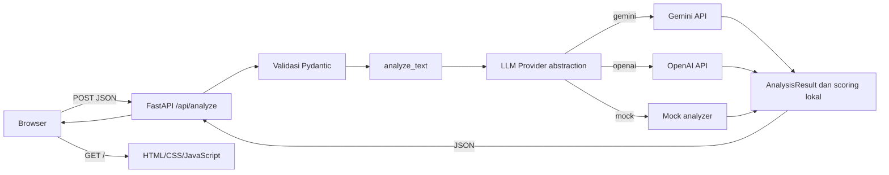

# Desain Sistem

## Komponen

### Frontend

`frontend/index.html`, `frontend/style.css`, dan `frontend/app.js` menyediakan form, loading state, tampilan hasil, dan pesan error. JavaScript mengirim `fetch('/api/analyze')`; API key tidak ada di browser.

### API Backend

`src/app.py` mengekspor FastAPI `app` dan menyediakan `GET /api/health` serta `POST /api/analyze`. Request divalidasi oleh Pydantic dan response memakai `AnalysisResult`.

### Shared Analysis Flow

`src/main.py` menyediakan `analyze_text()` untuk API dan CLI, serta `run_analysis()` untuk alur file-based lama. Kedua jalur menggunakan validasi dan analyzer yang sama.

### Analyzer Abstraction

`src/llm.py` memilih provider `mock`, `gemini`, atau `openai`. API dapat menerima analyzer injeksi untuk tes; jika tidak, provider mengikuti konfigurasi server. Tidak ada fallback otomatis.

### Schema dan Scoring

`src/schemas.py` menormalkan skill, menghitung `missing_skills`, skor, dan rekomendasi. API mengembalikan Pydantic `AnalysisResult`.

## Alur Request

## Error Handling

- Request Pydantic tidak valid atau input kosong: `422`, tanpa echo input.
- Timeout provider: `504`.
- Gagal terhubung ke provider: `502`.
- Gemini `429`: `429`; Gemini `503/504`: `503`.
- Kesalahan tak terduga: `500` generik. Detail internal tidak dikirim ke browser.

## Vercel

FastAPI app diekspor di `src/app.py`; `.python-version` memilih Python 3.14. Frontend disajikan dengan `StaticFiles`. Tidak ada database atau state request yang perlu dipersistenkan.
