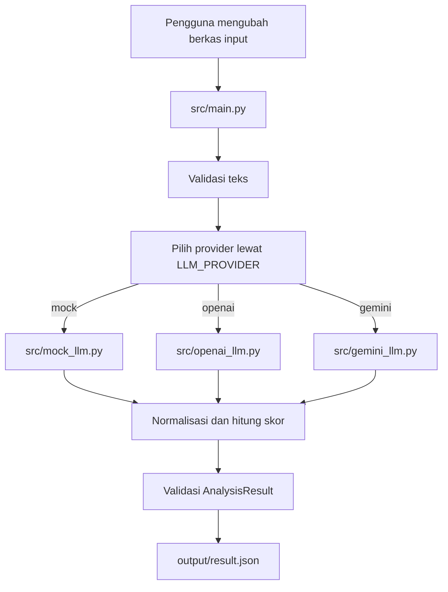

# Desain Sistem

## Komponen

### Input Processor

`src/main.py` membaca `data/job_description.txt` dan `data/candidate_profile.txt`. `src/validator.py` memastikan kedua input berisi teks.

### Analyzer Abstraction

`src/llm.py` membaca `LLM_PROVIDER` dari environment atau `.env`, lalu memilih implementasi:

- `mock`: `src/mock_llm.py`, pencocokan kata kunci lokal untuk pengembangan offline.
- `openai`: `src/openai_llm.py`, OpenAI Responses API dengan output terstruktur.
- `gemini`: `src/gemini_llm.py`, Google Gen AI SDK dengan JSON terstruktur.

### Result Schema dan Scoring

`src/schemas.py` mendefinisikan `AnalysisResult`, menormalkan nama skill, menghilangkan duplikasi, menghitung skill yang belum cocok, skor, dan rekomendasi. Skor serta rekomendasi dihitung aplikasi, bukan dipercaya dari keluaran model.

### Output

`src/main.py` menulis hasil tervalidasi sebagai JSON UTF-8 ke `output/result.json`.

## Alur Data

## Konfigurasi

- Gemini membutuhkan `GEMINI_API_KEY` dan dapat memakai `GEMINI_MODEL`.
- OpenAI membutuhkan `OPENAI_API_KEY` dan dapat memakai `OPENAI_MODEL`.
- Provider `mock` tidak membutuhkan internet atau kredensial.
- `.env` tidak boleh dimasukkan ke Git.

## Penanganan Kegagalan

Input kosong menghasilkan `ValueError`. Kegagalan jaringan atau provider live saat ini diteruskan oleh SDK dan dapat menghentikan eksekusi; pesan error ramah pengguna dan strategi retry aplikasi menjadi pekerjaan lanjutan.
