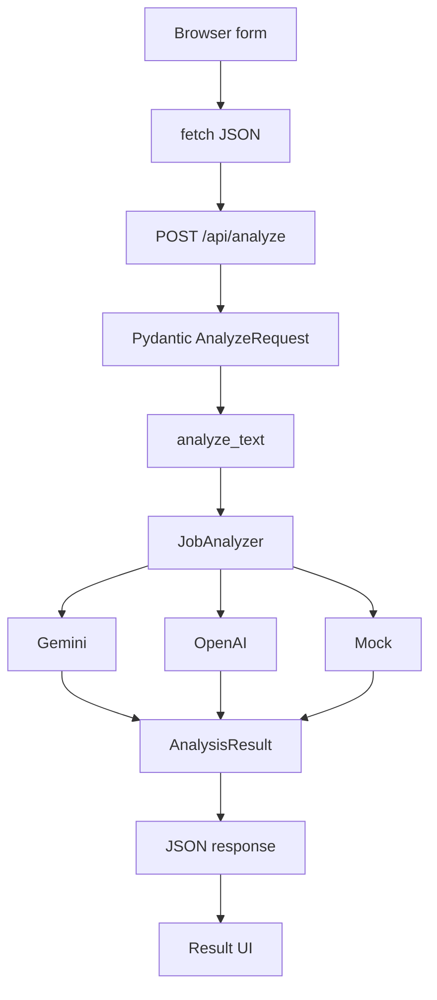

# Arsitektur Web V1

## Ringkasan

Web V1 memakai satu aplikasi FastAPI untuk API dan penyajian halaman. Browser berkomunikasi dengan backend; backend memakai provider analyzer yang sudah dimiliki proyek.

## Lapisan

1. **Frontend** — `frontend/` berisi HTML, CSS, dan vanilla JavaScript.
2. **HTTP/API** — `src/app.py` menyediakan route web dan JSON API.
3. **Validasi** — Pydantic memvalidasi request; `src/validator.py` dipakai oleh shared pipeline.
4. **Application flow** — `analyze_text()` di `src/main.py` memanggil analyzer tanpa membaca/menulis file.
5. **Provider** — `src/llm.py` memilih mock, Gemini, atau OpenAI.
6. **Schema dan scoring** — `src/schemas.py` membentuk result dan menghitung skor secara deterministik.

## Diagram

## Keputusan Teknis

- Shared analysis function menjaga aturan validasi dan provider tetap sama untuk CLI dan web.
- Provider diinjeksi ke `create_app()` agar endpoint dapat dites tanpa kredensial.
- Health check tidak menginisialisasi provider, sehingga tetap hidup saat provider belum siap.
- Static assets dilayani pada origin yang sama; V1 tidak membutuhkan CORS.
- API key hanya dibaca backend dari environment.
- Tidak ada database, autentikasi, atau fallback otomatis untuk V1.
