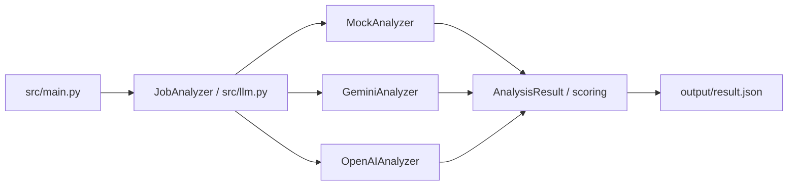

# Arsitektur Sistem

## Ringkasan

AI Job Research adalah pipeline command line yang membandingkan deskripsi pekerjaan dengan profil kandidat, menghitung skor kecocokan, lalu menyimpan hasil JSON.

## Lapisan Sistem

1. **Input** — `data/job_description.txt` dan `data/candidate_profile.txt`.
2. **Validasi** — `src/validator.py` menolak input kosong.
3. **Provider** — `src/llm.py` memilih mock, Gemini, atau OpenAI.
4. **Analisis** — provider menghasilkan judul, skill wajib, dan skill cocok.
5. **Schema dan scoring** — `src/schemas.py` menormalkan data dan menghitung skor/rekomendasi.
6. **Output** — `src/main.py` menyimpan `output/result.json`.

## Diagram Provider

## Prinsip Desain

- Provider mengikuti kontrak `JobAnalyzer.analyze(job_description, candidate_profile)`.
- Scoring deterministik berada di aplikasi agar provider berbagi aturan yang sama.
- Provider mock memungkinkan pipeline diuji tanpa API key atau jaringan.
- Kunci provider dibaca dari `.env` dan tidak disimpan dalam kode sumber.
